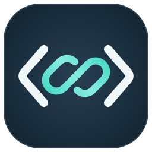

<p align="center">
  
</p>

<h1 align="center">CoLink · 连接你的代码</h1>

<p align="center">
  让网页 AI 看懂本机项目，并在你允许时修改、运行和验证代码。<br>
  一款轻量的 macOS 菜单栏应用。
</p>

<p align="center">
  <a href="https://github.com/YuyanYYt/Colink/releases/tag/v0.5.0b7">本期源码发行</a> ·
  <a href="https://github.com/YuyanYYt/Colink/releases/tag/v0.5.0b5">下载 macOS 安装包</a> ·
  <a href="docs/INSTALL.md">安装与使用</a> ·
  <a href="docs/AGENT_INSTALL.md">让 Agent 帮你安装</a> ·
  <a href="https://github.com/YuyanYYt/Colink/releases">历史版本</a>
</p>

**macOS 安装包：0.5.0 Beta 5（`0.5.0b5`，build 22）** · macOS 14+ · Apple Silicon · [MIT](LICENSE)

**本期最终源码：`0.5.0b7`**，见 [固定版本 `v0.5.0b7`](https://github.com/YuyanYYt/Colink/tree/v0.5.0b7)
和[本期发行说明](docs/RELEASE_0.5.0b7.md)。源码中的 macOS 构建元数据沿用 build 34。
包含统一源码读取、联合分析、Python / Java 有界数据流、分析限制诊断和本机工作区管理；
见[读取与分析入口](docs/CODE_ANALYSIS_ENTRYPOINT.md)、[M1 接口](docs/CODE_INTELLIGENCE_M1.md)、
[M2 边界](docs/CODE_INTELLIGENCE_M2.md)与[Java 数据流说明](docs/JAVA_DATAFLOW_BUILD34_20261016.md)。
本期发行提供源码。当前可下载的 macOS 安装包仍为 `0.5.0b5 / build 22`；本机历史
build 34 热修复包只包含写入恢复修复，与本期完整源码的功能范围不同。

2026-10-29 开发源码进一步修复分析预算误报，增加按选择器路由的常用分析入口、
TypeScript/JavaScript 有界结构关系、搜索预算优化及构建溯源清单。Python/Java
仍是值传播支持范围；这些开发改动尚未打包安装或公开发布，详见
[实现与验证记录](docs/CODE_INTELLIGENCE_20261029.md)。

后续 build 36 修复网页实测发现的 include 组合冲突、Python 调用阶段混淆和裁剪完整性，
保持默认 mode 隐藏与自动路由，复用 direction 表达单值来源/影响。相关验证和网页
验收分别记录，见 [网页实测修复说明](docs/CODE_INTELLIGENCE_REPAIR_20261029.md)。

Live 主要使用两个入口：`read_code` 定向读取文件、符号、搜索和少量显式文件，
`analyze_code` 查询关系、数据传播及任务 Diff，需要正文时可在同一次分析中附带。
已知文件可直接读取；跨文件理解先取得必要关系与源码证据。Live 完整工具集合为
40 个，含一个批量写入入口；八个被替代的旧入口已删除，更新后刷新连接工具。
历史 Mirror 保持原十五个只读工具与原有语义，详情见
[入口说明](docs/CODE_ANALYSIS_ENTRYPOINT.md)。

查看和清理项目工作区：设置 → 存储位置 → 项目数据。每行显示一个完整本机工作区、
原目录、包含的项目和全部占用；关闭连接后可将整个工作区及登记移到废纸篓，
原目录不存在或没有索引时也可操作。清理后退出列表，重新选择源码目录可重建。
源码、全局连接配置与写入恢复库保留；具体范围和恢复方式见
[本机工作区](docs/PROJECT_WORKSPACE_STORAGE.md)。升级前的正式 `build 29` 保留可安装回退包。

本版增加本机开发终端、固定数据库只读工具和局部代码索引更新。原生终端按当前
macOS 用户权限运行；可选隔离执行器目前只在已验证的 Darwin 27 上开放。
安装包声明最低 macOS 14；完整原生运行验收目前来自维护者的 macOS 27。
更新内容和验证边界见 [Beta 5 发行说明](docs/RELEASE_0.5.0b5.md)。

CoLink 把你选定的本机项目接入 MCP。你可以在 ChatGPT 网页端询问项目结构、查找
函数、理解跨文件依赖；需要改代码时，在本机打开写入开关，让 AI 精准编辑、创建
或删除文件。默认只读，项目由你在本机确认。开发终端按当前系统用户权限运行，
项目选择决定初始目录，不构成文件系统或数据库隔离。

## 能做什么

| 功能 | 你可以用它做什么 |
| --- | --- |
| 按需读取源码 | 一个入口读取文件、符号、搜索及少量显式范围；直接读取磁盘上已保存的文件 |
| 多项目管理 | 选择一个工作目录，分别启用其中的项目；在对话中指定项目|
| Python / Java 代码关系 | 联合查询类、调用、文件/模块关系与数据传播，可附带目标源码；引用、文件影响和全项目视图保留专用查询 |
| 精准写入 | 本机授权后按行插入、替换指定范围或唯一片段；修改前核对原文和文件哈希 |
| 批量写入 | 一次预检并提交最多二十笔显式编辑或创建，逐项保存恢复记录；执行中断明确报告已完成与待处理项 |
| 创建、移动与删除 | 创建文件和目录，在任务范围内移动源码与静态资源，删除明确指定的单个文件；不提供递归删除 |
| 任务 Diff | 查看同一任务跨多轮、跨文件的累计改动，不在普通问答里展示递增版本编号 |
| 网页开发终端 | 开发档直接运行本机命令、安装依赖与启动前后端，支持交互输入和输出；按当前 macOS 用户权限执行 |
| 环境与端口 | 查询本机实际工具版本、创建项目 Python 虚拟环境、查看监听与冲突；手动启动的本项目旧服务需本机确认后停止 |
| 数据库命令 | 只读档查看库表、结构和数据；开发档通过 mysql、psql、redis-cli、sqlite3 或驱动执行 CRUD、DDL 等账号允许的操作，无连接页和聊天卡片 |
| 存储位置 | 在齿轮设置内的折叠入口查看或更换本机运行数据目录；默认 `~/CoLink-data`，迁移先复制校验并保留原目录 |
| 本地 Git | 精确提交本任务选择的文件，保留用户原有暂存内容；首版不推送 |
| 菜单栏控制 | 启动、关闭、选择文件夹和管理项目；跟随系统深浅主题，不占 Dock 位置 |
| 可选自动匹配 Skill | 本机代码缺少上下文时优先读取；已经贴出足够代码时直接回答，无需每次手选技能 |

普通文本源码读取不限于 Python / Java；结构化关系分析目前重点支持这两种语言。
关系来自静态分析，动态调用、外部库内部实现等可能无法确定，工具会标明不确定项。
Skill 是否自动匹配由客户端决定，不保证每轮触发。

本版的结构索引按项目使用独立 SQLite，只保留当前一版；每项目磁盘上限
500 MiB，按需分配。最多同时打开 4 个项目索引，关闭连接后缓存保留在磁盘；
详细容量、关系复用与性能复测见 [安装版索引修复](docs/LIVE_INDEX_RUNTIME_FIX_20261008.md)。

## 开始使用

### 1. 安装应用

打开 [0.5.0 Beta 5 下载页](https://github.com/YuyanYYt/Colink/releases/tag/v0.5.0b5)，
下载 `Colink-macos-arm64.dmg`，将 `Colink.app` 拖入“应用程序”，然后打开 **CoLink**。
也可以下载 ZIP 安装。

安装包已包含 Python、MCP 运行依赖和隧道客户端，**不需要先安装开发环境**。
目前支持 Apple Silicon Mac（M 系列芯片），macOS 14 或更新版本。
Beta 包尚未完成 Apple Developer ID 签名和公证，首次打开可能出现系统安全提示；
详情与文件校验方法见 [安装指南](docs/INSTALL.md)。

### 2. 配置自己的连接

在菜单栏面板完成“首次连接设置”，填写你自己的 Tunnel ID 和运行密钥，再在
ChatGPT 中添加对应的私有 MCP 连接。首次配置步骤见
[连接指南](docs/INSTALL.md#只需首次完成你自己的-chatgpt-私有连接)。

连接通过出站私有隧道建立，不需要 VPS、路由器端口映射或本机公网入站端口。
你仍需要具有相应功能和权限的 ChatGPT / Platform 账号；安装软件不会自动获得这些权限。

### 3. 选择项目并启动

先用自带样例确认连接可用，再选择自己的项目或工作目录。在“项目管理”中启用
要提供给 AI 的项目，点击“启动”。新发现的项目不会自动获得访问许可。

在新对话中可以这样问：

> 看看我已连接的项目有哪些。请只读取项目清单。
>
> 解释指定项目的入口函数，并查一下它依赖哪些文件。
>
> 找到这个 Python 类的定义、调用位置，以及修改它可能影响的模块。

主面板提供 **只读 / 写入 / 开发** 三档模式。需要修改时选择 **写入**，确认准确项目，
并明确告诉 AI 要改什么。关闭连接、退出或重启后，写入和运行权限都会关闭。更新旧版后，应在 ChatGPT
原连接页刷新工具并新建对话。写入使用方法见 [读取与写入指南](docs/LIVE_USAGE.md)。

运行项目时选择 **开发**，为准确项目开启本机开发授权。网页可先查询环境和端口，
再通过 `terminal_*` 运行命令或数据库 CLI。终端以当前 macOS 用户权限运行，
项目 ID 决定授权入口和初始目录，并不隔离文件、网络或数据库。只读/写入档只有
固定数据库读取；本版没有数据库连接页、聊天卡片或逐库授权入口。

### 让 Agent 协助安装

把下面这句话交给你已有的本机编码助手：

> 请按照 https://github.com/YuyanYYt/Colink/blob/main/docs/AGENT_INSTALL.md
> 帮我安装 CoLink，先检查系统、版本和校验值，再说明安装计划；保留现有配置，
> 由我自己完成登录、密钥输入和项目授权。

Agent 可以协助下载、校验和安装，但不能代替账号授权或绕过系统安全提示。
想减少日常手动选择，另见 [自动匹配 Skill 的安装方法](docs/CHATGPT_SKILL.md)。

## 从源码运行

适合开发者、Linux 用户或使用本地 stdio MCP 客户端的用户。准备 Git、Python 3.11+
和 [uv](https://docs.astral.sh/uv/getting-started/installation/)，然后运行：

```sh
git clone https://github.com/YuyanYYt/Colink.git
cd Colink
uv sync --locked
```

让支持 stdio 的 MCP 客户端在仓库目录启动以下命令，即可只读连接自带样例：

```sh
uv run colink live --root examples/sample_project --project sample \
  --data-dir .code-context/live-sample
```

这不是网页访问地址，不会自动配置 ChatGPT 或打开写入权限。
多项目、HTTP、旧镜像兼容入口和客户端配置见 [命令行指南](docs/CLI_USAGE.md)。

## 版本更新

这里只列使用者能感受到的变化。开发阶段也保留在表中，不代表每个阶段都有独立安装包；
已发布包和对应源码可在 [Releases](https://github.com/YuyanYYt/Colink/releases) 找到。

| 版本 | 主要变化 |
| --- | --- |
| [**0.5.0 Beta 7 · 本期最终源码**](https://github.com/YuyanYYt/Colink/releases/tag/v0.5.0b7) | Python / Java 有界数据流、结构分析覆盖与限制诊断、可恢复批量写入与工作区管理；见[本期发行说明](docs/RELEASE_0.5.0b7.md)。本期提供源码 |
| [**0.5.0 Beta 5 · 公开预发行**](https://github.com/YuyanYYt/Colink/releases/tag/v0.5.0b5) | 只读 / 写入 / 开发三档、原生终端、固定数据库只读、局部索引和自定义运行数据目录；见 [发行说明](docs/RELEASE_0.5.0b5.md) |
| **0.5.0 Beta 4 · 维护源码** | 网页独立开发作业、原生隔离与有界存储、环境/端口/数据库引导、受控移动与本地 Git；公开发行状态和实际验收另行记录 |
| **0.5.0 Beta 2 · 公开发行** | 改善无 Git 项目发现和同名项目区分；发布直读、多项目及受控写入安装包；移除主动代码回退，代码历史交给项目 Git 管理 |
| 0.5.0 Beta 1 | 原文件按需直读、多项目授权、默认关闭的精准编辑与文件/目录创建、任务 Diff；后续源码补充单文件删除 |
| 0.4.3 · 开发阶段 | 修复自定义 Python 源码根的模块定位，支持显式源码根配置 |
| 0.4.2 · 开发阶段 | Python / Java 符号与关系查询；单文件上限提高到 4 MiB；品牌统一为 CoLink |
| [0.4.1](https://github.com/YuyanYYt/Colink/releases/tag/v0.4.1) | Diff 摘要、分页读取、连接状态检查、文件过滤与自动匹配 Skill |
| [0.4.0](https://github.com/YuyanYYt/Colink/releases/tag/v0.4.0) | 首个公开自包含 DMG / ZIP、首次连接设置、菜单栏运行和 Agent 安装指南 |
| 0.3.3 | 项目与插件统一品牌；旧镜像只保留当前和前一次代码状态，取消面向用户的递增版本编号 |
| 0.3.2 | 插件名称统一，Logo 间距与中心对称优化 |
| 0.3.1 | 精简界面、平滑 Logo，支持从“应用程序”重新打开 |
| 0.3.0 | 原生 macOS 毛玻璃菜单栏界面，加入启动、关闭和选择文件夹 |
| 0.2.0 | 本机持续托管和私有隧道连接，无需另购服务器 |
| 0.1.0 | 初版源码读取、搜索、Diff、同步和 stdio / HTTP MCP |

完整记录见 [CHANGELOG](CHANGELOG.md)。更新应用请先关闭并退出旧版，保留原配置与数据；
历史版本可下载，但不保证能直接读取新版数据格式，详见 [升级说明](docs/INSTALL.md#升级已有安装)。

## 使用前需要知道

- **你决定可读范围。** 只开放本机已确认的项目；不要直接共享个人主目录、系统目录或凭据目录。
- **私有连接不等于代码不出电脑。** 被查询到的源码会发送给使用它的 AI 客户端及其服务提供方。
- **写入默认关闭。** 本机许可和客户端工具确认相互独立；不会自动授予“全部权限”。
- **代码历史使用 Git。** 当前版没有主动代码回退按钮；修改前保存重要稳定点，任务 Diff 不是 Git 历史。
- **运行独立授权。** 首版非交互作业支持 Python、npm、Maven 和隔离 Shell；环境必须实际存在。Node 服务有 Unix socket 适配器，Python/JVM 服务需要相应接入，现有 Tomcat/Spring TCP 服务暂不能直接兼容。CPU、内存与进程数是监督软限制，原生保护不是虚拟机。
- **数据库需要实际验证。** 工具存在、端口开放和进程启动都不代表业务成功；迁移、CRUD、重启后数据及向量检索分别验证。Qdrant 目前提供连接配置与引导，执行需项目范围认证，尚未启用。
- **存储有界，但不是零。** 读取不保留完整源码镜像；结构索引、任务比较起点和中断保护仍占空间，并有容量限制。

过滤规则、隐私与写入边界见 [SECURITY](SECURITY.md)。

## 更多资料与贡献

[安装与升级](docs/INSTALL.md) · [读取与写入](docs/LIVE_USAGE.md) ·
[Python / Java 代码关系](docs/CODE_INTELLIGENCE.md) · [自动匹配 Skill](docs/CHATGPT_SKILL.md) ·
[技术架构](docs/ARCHITECTURE.md) · [开发与贡献](CONTRIBUTING.md)

欢迎通过 [Issues](https://github.com/YuyanYYt/Colink/issues) 提交问题和功能建议。
请附系统、芯片、应用版本和复现步骤，不要上传运行密钥或私人源码。

CoLink 使用 [MIT 许可证](LICENSE)。这是每位用户独立运行的开源软件，不是共享维护者
账号的公共连接，也不代表已经上架 ChatGPT 公共插件目录。

## 软件恢复锚点

维护者当前首选恢复基准：`0.5.0b7 / build 33`，本机固定标签为
`anchor/colink-0.5.0b7-build33-before-cross-language-20261016T152045`。
恢复前保留当前改动并检查运行数据兼容性，具体步骤和归档记录见
[build 33 恢复说明](docs/RECOVERY_0.5.0b7_BUILD33.md)。历史 build 19 材料保留；
这些维护者本机恢复材料不随公共源码发行分发。
