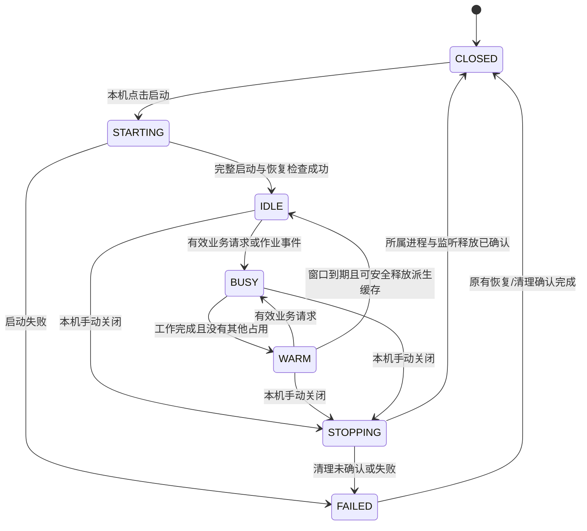

# CoLink 低能耗待命与关闭资源释放方案

日期：2026-10-10。状态：**设计与独立状态机推演完成，应用尚未实施**。

基准：`codex/colink-controlled-write`，应用代码提交 `6844c37`、维护文档提交
`e14eac5`；本机安装版 CFBundleShortVersionString 为 0.5.0，build 23。
本轮未启动真实作业、执行网页验收或修改应用包。用户已有的 WRITE_CONTRACT.md
修改与 sample_project 下的四个未跟踪目录保留。

## 1. 要达到的行为

1. 本机“已关闭”时，没有 CoLink 所属 MCP 后台、隧道、网页接收、文件监听、索引生产
   或周期性状态查询。保留静态菜单栏入口所需的少量 UI 内存；完全退出应用后才释放它。
2. 用户点击“启动”后建立现有连接；启动来源校验、授权、恢复检查与过滤继续执行。
3. 已连接且无工作时，接收通道等待消息，文件监听只处理真实事件，减少重复唤醒。
4. 有效业务请求到达后正常执行；响应完成后保留 300 秒活跃缓存窗口，后续请求顺延。
5. 300 秒到期只结束活跃缓存窗口，**不关闭连接、不取消作业、不撤销授权或删除任务**。
6. 网页沉默、页面关闭、没有日志输出，均不能被当作终端进程已经结束。
7. 文件创建/编辑/删除、依赖下载、终端、数据库 CLI/驱动、Git 和已有可选执行计划
   继续走原流程；新的能耗调度不增加执行限制、转发层或权限入口。

“保证不影响流程”在这里是待实现的契约和发布条件，不是已完成运行验收的声明。

## 2. 当前代码中的事实

| 当前入口 | 已核对的行为 | 设计影响 |
| --- | --- | --- |
| `macos/CodeConnect/Runtime.swift:430–437,476–483` | 初始化一个重复 5 秒 Timer，每次启动完整 desktop-status Python CLI；不检查面板是否可见 | 已关闭与隐藏面板也有不必要的查询，应首先处理 |
| `src/code_context/cli.py:10–18` | 普通命令入口提前导入 uvicorn、server 等模块 | 状态/配置查询可以使用轻量入口与延迟导入 |
| `src/code_context/desktop.py:263–318` | 原生控制管道 EOF/stop 导致整组关闭；监督循环每 100 ms 检查子进程 | 到期不能复用 stop/EOF；生命周期监督与业务空闲分开 |
| `macos/CodeConnect/Runtime.swift:877–909` | 手动关闭撤销授权并发送 stop | 保留现有手动关闭含义；关闭面板不是关闭连接 |
| `src/code_context/workspace.py:377–415` | close 会关闭 terminal、execution、控制、监听、后端和恢复库 | 自动空闲不可调用 WorkspaceRuntime.close |
| `src/code_context/live_watch.py:29,196–253` | 文件监听 500 ms 超时返回；每 30 秒元数据补偿；事件会触发相应项目检查 | 事件合并、按项目标脏与补偿检查可以独立优化 |
| `src/code_context/local_control.py:277,297–305` | 私有 socket 每 250 ms 退出 accept 等待并重新校验端点身份 | 属于安全相关监测，不能直接延长周期或删除 |
| `src/code_context/terminal.py:314–334` | 每 250 ms 检查作业授权，失效会取消；无作业时仍唤醒 | 无作业时可等待条件；有作业时保持原撤权时效 |
| `src/code_context/execution_process.py:480–507,735–760` | 调度器无作业仍每 100 ms 醒来；close 取消未终结作业 | 无工作时可等待事件，关闭仍必须证明作业树已结束 |
| `src/code_context/project_index.py:139–159,241–260` | 索引按需取得；整个 close 关闭协调器并取消待办 | 空闲只释放未租用的派生缓存，不能直接调用整个 close |
| `src/code_context/live.py:197–231; live_index.py:638–690` | 原文件直读与结构查询各有实际输入/上下文校验 | 低能耗监听不替代查询时的真实校验 |

2026-10-09 的已完成诊断测得：一次完整 desktop-status 查询用时 0.718 秒，
CPU 时间 0.697 秒；18 秒采样捕获三个该类子进程。此为前次诊断数据，**本轮没有复测**。
2026-10-10 本轮只读进程快照未发现 CoLink 进程；这是完全退出时的快照，不能证明
现有菜单栏“已关闭”已经满足新的无轮询要求。

## 3. 比较四套候选策略

| 方案 | 定义 | 好处 | 边界与结论 |
| --- | --- | --- | --- |
| A：事件触发＋5 秒窗口 | 响应后短暂保留缓存，到期转空闲；作业保护有效 | 更快释放可重建内存 | 在 AI 思考、两次工具调用间隔稍长时频繁冷热切换；保留为可选策略，默认不采用 |
| B：滑动 5 分钟后关闭后台 | 到期发送 stop 并退出 MCP/隧道 | 空闲后台资源释放彻底 | 会中断服务、准备/排队作业和未完成任务，且断开后现有网页无法直接唤醒；排除 |
| C：纯事件驱动，缓存一直保留 | 接收消息后工作，不设置缓存窗口 | 简单，无固定激活截止点 | 长时间不用时缓存仍留在内存，不满足 5 分钟后释放闲置缓存的目标；可作第一阶段基础 |
| **D：事件触发＋滑动 300 秒＋作业保护** | 保留现有连接，窗口到期只释放安全的派生缓存 | 兼顾可唤醒、连贯调用和资源回收 | **推荐**；安全监测必须保持等效，正常作业时仍有实际运行开销 |

此处“活跃”表示缓存保温与随时处理任务，不表示持续扫描或强制 CPU 满载。
更高 CPU 频率由系统按实际工作调度，不设“全功耗”开关。

### 独立推演证据

在 `.artifacts/design/energy-idle-20261010/compare_policies.py` 中，将相同的
33 条合成事件场景分别送入上述四套策略，使用推荐 D 的契约作为比较规格。
结果保存在同目录 `comparison.json`，复现命令：

```sh
uv run --locked --no-sync python .artifacts/design/energy-idle-20261010/compare_policies.py
```

| 策略 | 符合推荐规格的场景 | 业务/生命周期保护类不符 | 窗口类不符 |
| --- | ---: | ---: | ---: |
| A | 27 / 33 | 0 | 6：其窗口本来就较短 |
| B | 11 / 33 | 14 | 8 |
| C | 25 / 33 | 0 | 8：没有到期缓存释放 |
| D | **33 / 33** | **0** | **0** |

A/C 的窗口不符是设计选择的差异，不表示它们已发生真实业务错误。B 的风险是
“没有网页请求就关闭进程”的逻辑后果。模拟中的 backend/listener 标记是拟定资源
契约，不是活动监视器、socket 或文件监听的实测结果。
部分合成作业持续 900 秒，用于隔离能耗窗口的影响；不是当前有限终端作业允许
运行 900 秒的证明。33/33 只证明该抽象模型与列出的场景一致，**不证明安装版
已实现、不证明真实 MCP/终端正确、不证明节电幅度或性能**。

## 4. 推荐状态机



已有写入恢复阻塞状态作为独立标记保留；不能因为状态显示 IDLE 就宣布恢复已完成。
已有外部连接状态也独立保留，不能称“已关闭”但实际上另一个窗口仍在运行连接。

| 状态 | CPU/线程预期 | 内存/连接预期 |
| --- | --- | --- |
| CLOSED | 业务后台与重复状态查询为零；静态 UI 等待用户事件 | 无所属 Python、隧道、Codex 辅助进程、socket 或文件 watcher；UI 有少量内存 |
| STARTING | 执行一次完整启动校验与资源初始化 | 建立连接；写入/开发沿用默认关闭 |
| IDLE | 等待消息/文件事件，不做完整周期查询和持续项目扫描 | 保留现有连接、轻量控制与必要上下文；未租用的派生缓存可释放 |
| BUSY | 按实际任务正常执行；既有安全监管继续工作 | 活跃请求、作业、准备、提交等所需资源保持有效 |
| WARM | CPU 仍可等待；最多保留 300 秒可重用缓存 | 没有后台空转预热或全项目预扫描 |
| STOPPING/FAILED | 必要清理或原有故障处理 | 尚有资源时如实显示关闭中/关闭失败，不能冒充零资源 |

## 5. 300 秒滑动窗口的精确定义

### 5.1 延长窗口的事件

- 已通过既有输入/来源/权限检查而开始执行的业务请求。
- 已接纳业务请求的完成、错误返回或已完成取消处理。
- 正在保护的后台作业/索引构建/原子提交**确认完成**，使最后一个占用释放。
- 本机明确发起需要业务后端工作的操作。

对每个上述事件，使用同一运行世代的单调连续时钟：

```text
warm_until = max(warm_until, now + 300 seconds)
```

响应结束重新计时，避免耗时较长的请求刚返回就立即进入冷缓存状态。
例如 10:00 响应完成，截止 10:05；10:04 又完成响应，截止改为 10:09。
10:05 若下载仍在执行，下载继续；下载 10:20 完成，最后占用释放后可保温到 10:25。

### 5.2 不延长窗口的事件

协议保活/健康探测、工具静态说明、后台 UI 自动刷新、被拒绝/无效请求、文件变动
和日志输出不延长业务窗口。必要回答和正确性校验仍执行，不能为了“无激活”假报 ready。
文件变动标脏、合并事件并按需调整监听集合；普通编辑或构建风暴不强迫全项目持续保温。

### 5.3 计时器实现约束

- 一个可撤销的单次截止事件，延长截止时更新 deadline/generation；不增加每秒倒数轮询。
- 请求进入、释放资源租约与到期处理在同一串行状态队列/锁内决定；不在锁内执行 IO。
- 到期与新请求同刻发生：先到期则释放可重建缓存后正常接纳请求；先接纳则已有租约
  阻止释放。两种顺序都不能丢请求、断连接或复活已撤销授权。
- 建议 macOS 使用包含系统睡眠时间的连续单调钟（Swift ContinuousClock 或同语义
  的已核验时钟）；业务运行端计算实际 deadline，UI 只呈现结果，不建立两个独立截止点。
- 系统唤醒时重新检查连接与实际作业状态、评估截止；系统时间手动调整不改变窗口。
- 不把激活截止持久化成自动启动意图；重启仍须本机启动，并重新按原流程授权。

## 6. 作业保护与允许释放的资源

### 6.1 硬占用：存在时不释放其使用资源

| 占用 | 接纳与释放位置 | 关键边界 |
| --- | --- | --- |
| 进行中的 MCP/本机业务处理 | 接纳到响应/取消清理完成 | 长时间没有输出仍是进行中 |
| 终端、依赖下载、开发服务及后代 | 任务入队/准备前登记，实际作业树终结后释放 | queued/starting/running、静默下载和长驻服务都计入 |
| execution 的准备、排队与写回 | 实际状态与回调，而非 HTTP 响应结束 | preparing→queued→running 的转移原子完成，不出现假空闲间隙 |
| 原子写入/删除/恢复提交 | 原协调器临界操作开始到验证/清理结束 | 不在 rename、提交或回读期间降级依赖资源 |
| 索引生产与被查询租用的事实库 | futures 与现有 leases | users>0 或仍有构建不得关闭/取消 |

保护的是任务与资源生命周期，不是长期强制让 CPU 做额外工作。后台服务等待连接时
可以阻塞等待；只要实际任务未结束，就不能用能耗窗口杀它。

### 6.2 软占用：可空闲等待，但上下文不能被销毁

等待下一条网页指令的写入任务、未完成恢复记录、待确认写回和已接纳取消请求，
必须保留任务 ID、幂等回执、源版本、恢复正文、授权 epoch 与对应锁。
可以停止额外扫描，但不能调用 `_retire`、`collect_unreferenced`、数据库清空、
`disable_write` 或完整 runtime close。业务原有保留/回收规则继续在其原入口执行，
不得由节能计时器新增触发。本方案不修订既有“最新完成任务”保留策略。

### 6.3 到期允许释放什么

仅释放不在使用中的可重建内存缓存与相应未租用索引连接，不删源码、索引数据库、
恢复库、执行账本、配置、密钥或锁文件。保留现有 MCP/stdio/隧道、本机控制身份、
恢复 store、来源上下文与已授权项目。
索引池需要单独的 `trim_idle` 操作：在池锁下挑选 users=0 且无生产任务的对象并
移出池，在锁外关闭该对象；共享 executor 与服务协调器本身继续可用。不能调用
当前 ProjectIndexService.close，它会结束整个池并取消任务。
后续结构查询重新租用/打开缓存并执行现有全量输入/版本校验，不信任“没收到事件”。

## 7. “已关闭”的完整资源契约

### 7.1 本机关闭连接

沿用本机手动关闭的原行为：先拒绝新操作并撤销对应授权，再请求停止所属作业树，
等待清理结果，关闭 watcher/控制/索引/recovery 等资源，结束本连接的后台组。
有作业时，手动关闭会影响它们——这是已有关闭语义，与自动空闲不同。不得把手动
关闭偷偷改成“服务继续运行但 UI 显示已关闭”。关闭面板只隐藏 UI，业务连接继续。

只有以下事实全部成立才显示“已关闭”：

- 本窗口所属后台组、作业及可信辅助进程均已确认结束；不是只看直接子 PID。
- 不持有本次连接的文件监听、网络连接或本机控制监听。
- 不存在本窗口的周期完整状态查询、索引工作或监督进程。
- 原生 UI 清空已确认授权与动态项目/任务视图，取消过期状态请求及计时器。

静态目录选择与配置留在磁盘。关闭期间不监听这些目录的变化；下一次启动重新
进行真实身份、忽略策略、登记与恢复检查。项目在关闭期间被删除/替换时，启动按
原规则拒绝，不根据显示缓存接受新目录。用户主动打开面板或进入项目管理可以触发
一次本机读取；本轮操作结束后不留守扫描或守护进程。

清理失败时保持关闭中/关闭失败，保留诊断及恢复材料，禁止叠加启动新实例。
外部连接属于其拥有者，应显示“由其他窗口连接”，不得为满足零资源任意杀它。

### 7.2 内存承诺

菜单栏入口与启动按钮存在时，AppKit/UI 进程仍需少量内存；不能承诺 RSS 精确为零。
“已关闭”承诺的是**业务后台内存释放、无上述后台工作与监听**。
“退出应用”在全部所属资源确认结束后释放 UI 进程；菜单栏入口随之消失。
OS 文件页缓存、静态配置和日志留在磁盘，不等于 CoLink 仍在运行。

## 8. 具体改动地图与安全实施顺序

### 阶段一：已关闭与重复查询

- `Runtime.swift`：CLOSED 不安装重复刷新 Timer；取消旧查询/超时回调并以 stateEpoch
  隔离晚到结果。配置状态和选定路径使用轻量读取，面板打开时按需读取。
- `cli.py` 或新的内部轻量命令入口：状态/配置路径延迟导入服务模块。沿用现有身份
  校验和控制协议，不读取真实密钥到 UI，不创建新的后台服务。
- `main.swift`：面板显示/隐藏通知现有控制器；保持“隐藏面板”与“手动关闭”区别。
- 对自有连接使用已有 Process.terminationHandler/控制管道事件及时通知退出。
  外部连接以已有控制入口按需核验，不能假设不存在。
- 这一阶段不直接取消已连接状态下现有的安全确认周期。先做轻量入口；后续改成
  复用已运行监督进程查询，避免每次冷启动 Python。直到事件/查询具有等效的失联与
  授权不一致检测证据，现有确认周期继续适用，不以降低频率换取安全退化。

### 阶段二：滑动窗口与业务占用

- 在现有 workspace 运行进程内增加小型调度状态对象与事件记录，不新增代理进程。
- 在工具接纳/完成、作业登记/完成、索引 lease/future、关键提交处接入生命周期通知。
  回调不能阻塞业务锁，不更改工具签名、返回语义、授权、幂等或已有执行预算。
- 复用现有原生应用与 desktop-run 的私有 stdin/stdout 管道，新增有界的内部状态
  查询/事件帧；命令仅允许原有 stop 与明确的内部状态操作，不接受任意 shell 文本。
  不增加后台进程、公共端口或网页工具。监督进程复用已有本机控制入口读取真实状态；
  身份/来源检查仍执行，重模块只在进程内载入一次。
- 事件携带本连接 epoch、单调 sequence 与有限状态，不带源码、命令正文或密钥；
  Native 只接受自己拥有进程的流，拒绝旧 epoch/倒序/超大帧。事件队列有界并合并
  重复状态；溢出要求完整再核验，而不能丢弃业务请求或阻塞提交。
- 后端 ready/权限失效、控制流 EOF、监督进程退出及时推送或由原有安全通道确认。
  不能只根据 UI 缓存判断授权；通知缺失/解析失败时进入未知并沿原 fail-closed
  路径核验/停止，不能维持虚假的“已连接且已授权”。对缺乏可靠事件来源的远程
  隧道健康项，保留轻量有界检查；保持当前必要的时效，调用现有进程而非再启动 CLI。
- 新状态可作为控制 status 的附加展示字段：power_state、warm_remaining、busy_reasons；
  不把它当作授权凭据，不向普通源码回答暴露内部计数或错误输入。
- deadline 调用 trim_idle/暂停可延后维护，**不调用 desktop stop、WorkspaceRuntime.close、
  authorize/disable/recover 或 ProcessManager.cancel**。

### 阶段三：空闲线程与监听

- 无作业时，terminal 授权 monitor、execution dispatcher 使用可唤醒的条件等待；
  新作业、撤权、shutdown 与原有到期回收事件必须唤醒等待者。
- 正在运行作业时保留原授权/进程树监管时效及资源预算。不能为了省电降低撤权检测。
- 文件事件合并、按项目标脏，避免空闲期固定全项目补偿扫描；保留必要的原生事件
  接收。新目录、通知溢出、监听失效与系统唤醒后的完整性由下一次真实查询/发现及
  有界修复补偿确认。丢失通知时必须标示退化，不能把旧索引宣称为最新。
- 本机控制端点的 250 ms 身份监测先保持原样。只有经过端点/祖先身份替换、失联、
  shutdown 并发与 sticky revocation 的等效验证后，才用受控事件等待替代。
  无法证明等效的安全监测保留其原周期，接受少量必要待命开销。
- 可延后的缓存/元数据维护才使用系统后台调度；恢复、取消与权限撤销不属于可延后项。

各阶段先达到原功能契约再启用节能行为；纯设计当前不打包。实际代码落地后仍按
LOCAL_UPDATE_POLICY 进行构建、安装与基础运行验证，不自动开启写入/开发授权。

## 9. 功能缺陷与取舍边界

| 情况 | 允许的取舍或已有边界 | 不能发生的变化 |
| --- | --- | --- |
| 空闲缓存释放后的首次结构查询 | 可能多一次打开数据库/装载缓存；仍使用原查询预算和 not_ready 语义 | 额外强制等待 5 秒/5 分钟，返回未经校验的旧结果 |
| 5 分钟网页无请求 | 活跃缓存可降级 | 自动断开、取消下载/服务、销毁任务或重新要求已有效授权 |
| 协议心跳持续到达 | 轻量回答，连接仍有少量开销 | 每次心跳加载索引或持续延长活跃窗口 |
| 没有终端输出 | 实际进程状态决定生命周期 | 据此认定完成或取消 |
| 文件通知丢失/目录增删 | 标脏/退化并在真实访问时验证；必要时有界补偿 | 漏读新文件、漏报删除、假报索引最新 |
| 未完成写入/恢复 | 保留上下文和恢复记录；原阻塞规则继续 | 到期自动完成、退役、回滚或清空 |
| 原有有限终端作业 | terminal.py 目前要求 0 < timeout_seconds <= 300；execution 有同类既有预算 | 以能耗窗口新增时限，或声称本方案已放宽这 300 秒限制 |
| 原有开发服务 | ProcessManager 的现有 service_idle_seconds 为 1200；status/output 等原路径续租 | 用新的 300 秒窗口替换 1200 秒租约，或后台偷偷续租到永久运行 |
| 断网、网页关闭 | 按已有连接/控制/租约策略执行；低能耗不能保证断网后任务永久存活 | 把节能自动空闲伪装成断网/撤权，或屏蔽已有真实失联处理 |
| 手动关闭、退出、撤权 | 按原生命周期取消/清理，应明确呈现失败 | 为省电提前宣布清理成功，或以作业保护绕过用户撤权 |
| 已关闭但保留菜单栏 | UI 有少量驻留内存，无业务后台监听/扫描 | 承诺可见菜单栏与整应用零内存同时成立 |
| 高负载编译/安装 | 实际工作本身有 CPU/网络/磁盘开销 | 对正在执行的正常任务强制降速或偷偷限制功能 |

主要预期收益是消除重复进程启动、重模块加载、无任务轮询与重复扫描；目前没有
节电比例、唤醒延迟或稳定性实测，不承诺 90% 节电、零功耗或全部工具零延迟。

## 10. 将来实施前后的验收门槛

以下是**未来代码实施的发布条件**，本轮只做设计推演，不执行这些真实测试。

1. CLOSED 保持十分钟：活动监视器/所属进程与 FD 清单证明无业务后台、监听和周期查询；
   打开面板、重选文件夹与再次启动仍可用。区分菜单栏关闭与完全退出的内存。
2. 实际文件 create/read/edit/delete/diff/finish，启用与撤销授权均按原流程；到期前后
   同一 task/project/snapshot/请求幂等语义保持正确，未经授权输入不激活业务窗口。
3. terminal 依赖下载/编译/运行与服务端口：网页超过五分钟不请求时，处于原有效时限
   内的作业不被能耗窗口取消；检查完整作业树、状态、输出游标、退出码与端口。
4. 准备/排队、索引生产、提交、回读、写回、取消和截止同刻到达的竞争条件。
5. 关闭期间文件改动、开启期间通知溢出、新目录、删除/替换、忽略策略变化：实际
   文件/来源身份核验和索引上下文仍拒绝冲突，无旧事实误发布。
6. 控制 socket 或祖先替换、控制失联、撤权、断网、睡眠唤醒、关闭失败、重启：原有
   fail-closed 与 sticky revocation 不退化；旧授权和运行意图不得被计时器复活。
7. 同一负载与空闲状态比较 CPU 时间、子进程创建、唤醒、IO、内存与请求延迟；短时
   活动监视器读数不替代可比测量，“12 小时电源”历史分数不能用于立即验收新方案。
8. 相关检查、必要回归与真实网页证据满足后再覆盖本机安装版；保留当前可用 build 23
   与对应安装包至替代版本验收成功。失败时只回退应用改动，不重置当前数据。

## 11. 需求核对与完成范围

| 用户要求 | 本设计的交付证据 |
| --- | --- |
| 先比较几套方案 | 第 3 节四套策略＋33 条合成事件比较及可复现文件 |
| 响应后 5 秒或 5 分钟，再响应顺延 | 第 3、5 节短窗口对比与推荐 300 秒精确定义 |
| 网页沉默时终端、下载继续 | 第 6、9 节真实作业状态保护及已有 300/1200 秒边界 |
| 先保证功能，再优化 | 第 8 节安全实施顺序与第 10 节未来发布门槛 |
| 已关闭不监听网页与文件 | 第 7 节资源清单、关闭确认与下一次启动重验证 |
| 关闭释放内存 | 第 7 节业务后台释放与 UI/完全退出的可实现边界 |
| 完整功能缺陷边界、写入文件 | 本文件第 6、9 节＋第 8 节逐模块改动地图 |

本轮完成的是完整方案与逻辑推演。生产实现、实际功能回归、能耗对比与新应用安装
均未执行，不能将本文件或模型结果标成已完成节能改造。

## 12. 官方机制参考

本方案是在当前 CoLink 流程上作的设计选择；以下官方资料支持机制，不代表官方
验证过本方案或当前安装版：

- [Apple：减少定时器、按事件唤醒](https://developer.apple.com/library/archive/documentation/Performance/Conceptual/power_efficiency_guidelines_osx/Timers.html)。
- [Apple：调度可延后的后台维护](https://developer.apple.com/library/archive/documentation/Performance/Conceptual/power_efficiency_guidelines_osx/SchedulingBackgroundActivity.html)。
- [Apple：连续单调钟与睡眠](https://developer.apple.com/documentation/swift/continuousclock/clock-implementations)。
- [MCP：stdio 消息与进程生命周期](https://modelcontextprotocol.io/specification/2026-07-28/basic/transports/stdio)。

无需因此升级当前 MCP SDK、改传输协议或新增常驻启动器。
